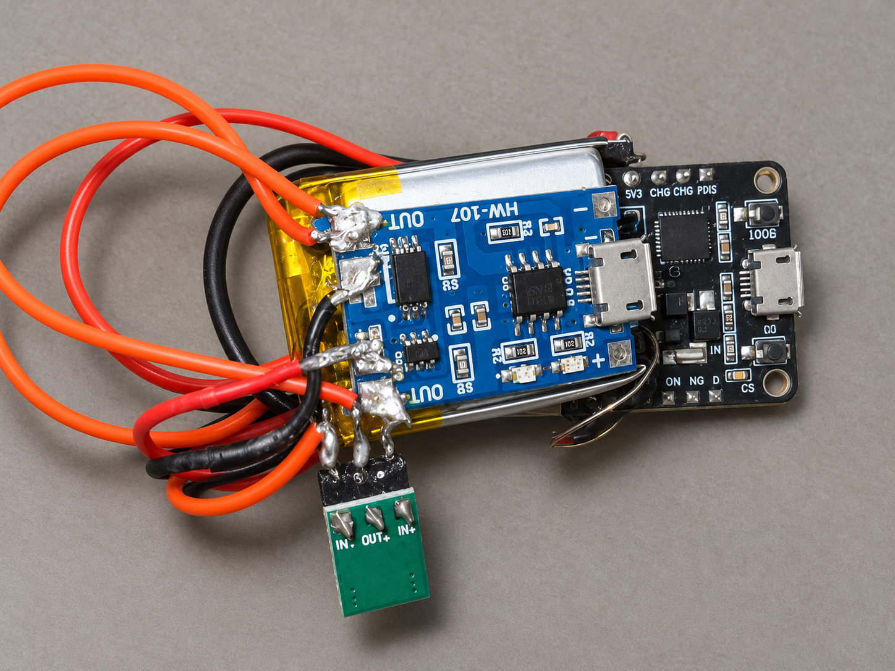

# Airmouse
As the name implies, this mouse can be used witout any surface, it works by moving your hand in the air while holding this device.

# Photo

# Demo

# Items 

mpu 6050: https://robu.in/product/mpu-6050-gyro-sensor-2-accelerometer/

3.3 v buck and boost: https://robu.in/product/dc-dc-1-8v-5v-to-3-3v-boost-and-buck-power-module/

Charging module: https://robu.in/product/tp4056-1a-lipo-battery-charging-board-micro-usb-with-current-protection/

esp32

1s battery

tp4056

